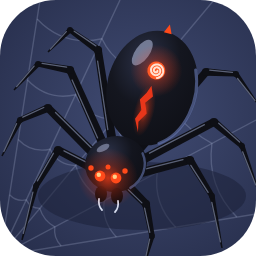
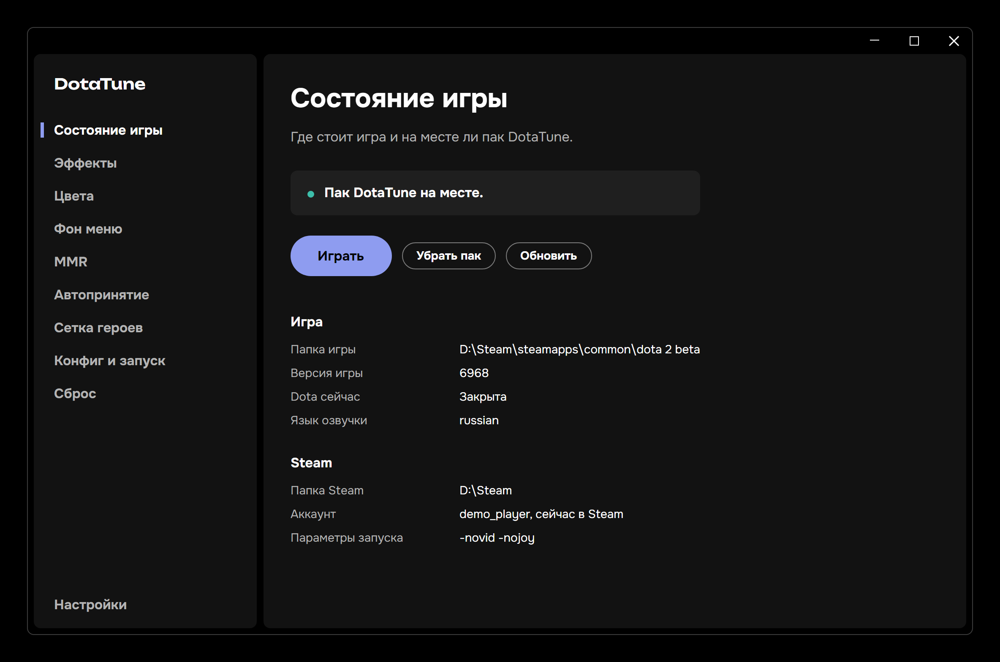
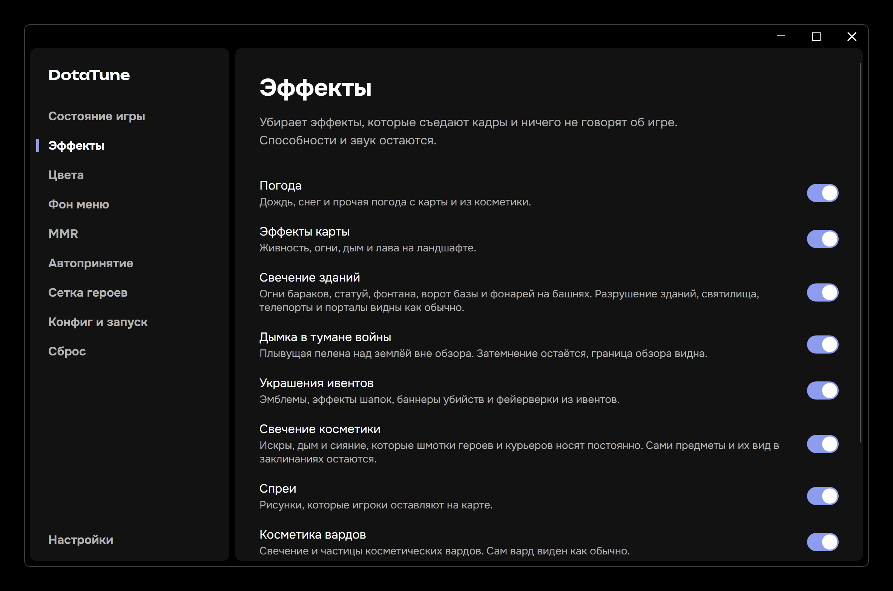
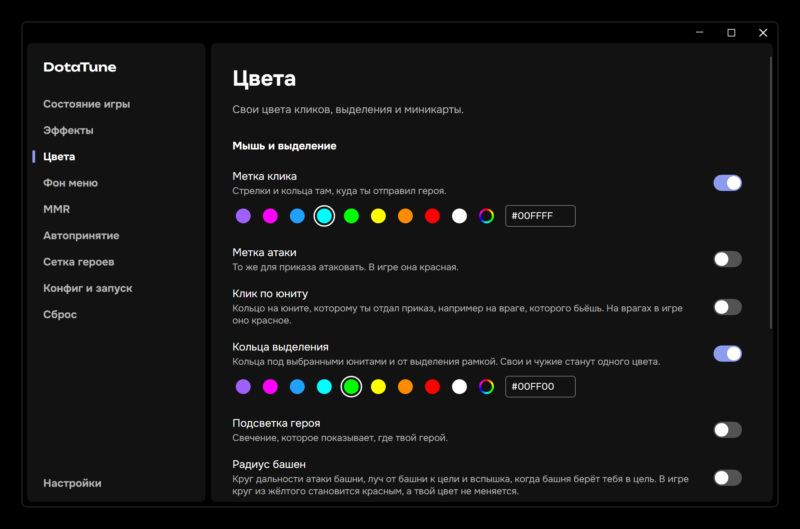
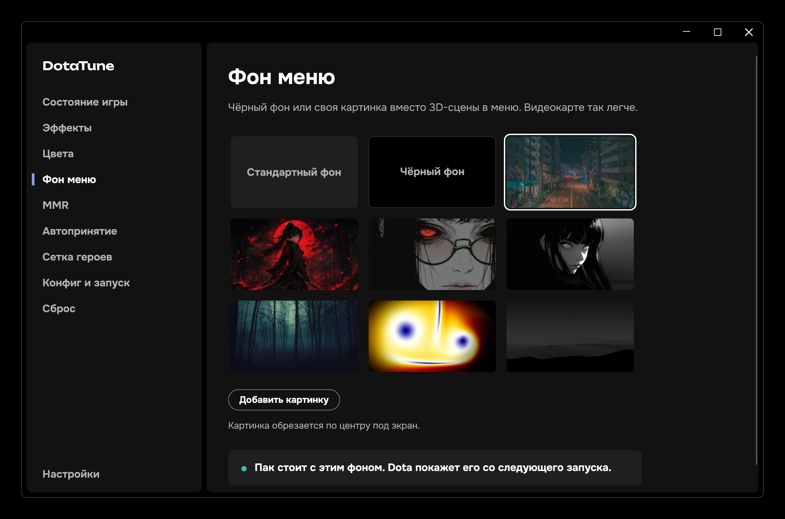
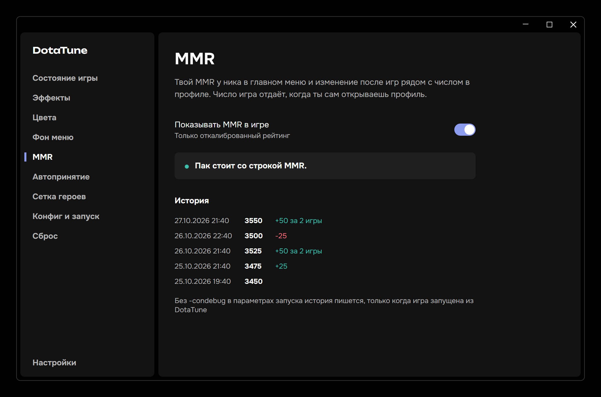
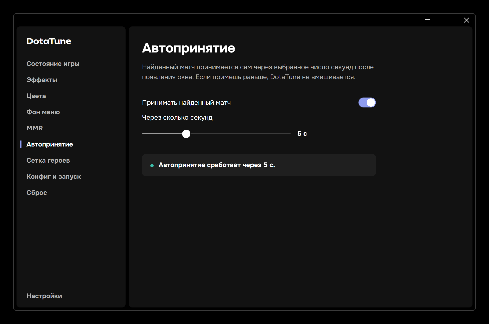
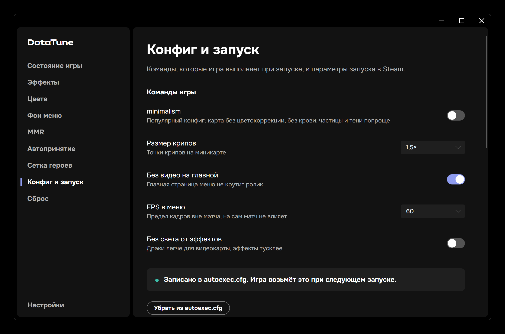

<div align="center">



<h1>DotaTune</h1>

<p>Настройка Dota 2 в одном окне: меньше лишних эффектов, свои цвета, фон меню, MMR в игре и автопринятие матча.</p>

<a href="https://github.com/zxczxczxczxczxczxc1111/dotatune/releases/latest"></a>

<sub>Версия 0.3.0 для Windows 10 и 11 x64</sub>

<a href="#возможности">Возможности</a>&emsp;<a href="#экраны">Экраны</a>&emsp;<a href="#установка">Установка</a>&emsp;<a href="#справка">Справка</a>

</div>

<br>



<p align="center"><sub>Данные на снимках демонстрационные</sub></p>

DotaTune собирает из выбранных настроек свой пак и кладёт его к файлам игры, как это делают другие моды для Dota 2. В память игры и её exe программа не лезет. Остальное она пишет туда, где игра и Steam сами держат настройки: в `autoexec.cfg` и `boot.vcfg`, в параметры запуска, в файл сетки героев и, если переносишь или возвращаешь настройки, в файлы аккаунта Steam. Страница «Сброс» убирает из игры всё, что поставил DotaTune.

## Возможности

### Эффекты

- **Девять групп эффектов**, каждая выключается отдельно: погода, живность и огни на карте, свечение зданий, дымка в тумане войны, украшения ивентов, свечение косметики, спреи, косметика вардов и вспышки автоатак
- **Нужное на месте**: способности, звук, снаряды, сами варды и граница обзора видны как обычно

### Цвета

- **Клики и выделение**: свой цвет метки клика, метки атаки, кольца на юните, колец выделения и подсветки героя
- **Миникарта**: свои цвета для своих, врагов, нейтралов и Рошана
- **Любой цвет**: девять готовых или свой в палитре с квадратом насыщенности, полосой оттенка и кодом цвета

### Меню и матч

- **Фон меню**: чёрный фон, одна из семи картинок или своя вместо 3D-сцены, видеокарте так легче
- **Без ивентов на главной**: столбец плиток ивентов справа прячется одним переключателем
- **MMR в игре**: число у ника в главном меню и изменение после игр рядом с числом в профиле. Число игра отдаёт, когда ты сам открываешь профиль, а программа хранит историю всех показаний по аккаунтам
- **Автопринятие**: найденный матч принимается сам через 1-15 секунд. Если примешь раньше, DotaTune не вмешивается
- **Сетка героев**: готовые раскладки по позициям по статистике Stratz и Spectral, обновляются раз в день, и арт-сетки. Твои сетки остаются, раскладки DotaTune помечены `#DotaTune-Import`

### Конфиг и запуск

- **Копия настроек**: графика, горячие клавиши, бинды, настройки игры, параметры запуска, свой `autoexec.cfg`, сетки и сборки в одном zip-файле. Возвращается одной кнопкой и по частям: после «Сброса», после неудачных правок или на другом компьютере
- **Команды игры** в своём блоке `autoexec.cfg`: цвета и размер крипов на миникарте, FPS в меню, главная без видео, драки без света от эффектов и популярный конфиг minimalism
- **Параметры запуска Steam**: `-novid`, `-nojoy` и `-condebug`, а заодно уборка параметров, которых в игре уже нет. Записать их можно только при закрытом Steam, поэтому программа предложит его перезапустить
- **Перенос между аккаунтами**: горячие клавиши, настройки игры, бинды, сетки, сборки и графика с одного аккаунта Steam на другой
- **Наборы**: эффекты, конфиг и параметры запуска одним кодом `DT1-`, а файлом `.dotatune` ещё сетки, клавиши и настройки игры

### Состояние и сброс

- **Состояние игры**: где стоят Steam и Dota, версия игры, чужие моды и на месте ли пак. Кнопка <kbd>Играть</kbd> запускает игру и проверяет, подключила ли она пак
- **Сброс**: одна кнопка возвращает игру к виду до DotaTune, вместе со старыми паками, о которых программа уже не помнит
- **Русский и английский**: язык интерфейса программы выбирается в настройках
- **Обновления**: новая версия ставится сама, потом карточка «Что нового» показывает, что поменялось, и предлагает пересобрать пак

## Экраны

<table>
  <tr>
    <td width="50%"><a href="assets/readme/effects.webp"></a></td>
    <td width="50%"><a href="assets/readme/colors.webp"></a></td>
  </tr>
  <tr>
    <td align="center"><b>Эффекты</b><br><sub>Девять групп, каждая выключается отдельно</sub></td>
    <td align="center"><b>Цвета</b><br><sub>Клики, выделение, подсветка героя и миникарта</sub></td>
  </tr>
  <tr>
    <td width="50%"><a href="assets/readme/menu.webp"></a></td>
    <td width="50%"><a href="assets/readme/mmr.webp"></a></td>
  </tr>
  <tr>
    <td align="center"><b>Фон меню</b><br><sub>Чёрный фон, готовая картинка или своя, ивенты на главной скрываются</sub></td>
    <td align="center"><b>MMR</b><br><sub>Строка у ника и история показаний</sub></td>
  </tr>
  <tr>
    <td width="50%"><a href="assets/readme/accept.webp"></a></td>
    <td width="50%"><a href="assets/readme/config.webp"></a></td>
  </tr>
  <tr>
    <td align="center"><b>Автопринятие</b><br><sub>Задержка от 1 до 15 секунд</sub></td>
    <td align="center"><b>Конфиг и запуск</b><br><sub>Копия настроек, команды игры, параметры Steam, перенос и наборы</sub></td>
  </tr>
</table>

## Установка

Понадобится Dota 2 в Steam, хотя бы раз запущенная. Пак работает, только если игра сама подгрузит его при запуске, а такие файлы она берёт из папки своего языка озвучки. Язык озвучки игра записывает при первом запуске, и до этого DotaTune не знает, в какую папку положить пак. Подробнее в справке, в разделе «Что DotaTune меняет в игре».

1. **Установи.** Скачай `DotaTune-Setup.exe` со страницы [последнего выпуска](https://github.com/zxczxczxczxczxczxc1111/dotatune/releases/latest) и запусти. Программа ставится для текущего пользователя, без прав администратора, .NET отдельно не нужен.
2. **Выбери настройки** на страницах программы и нажми <kbd>Поставить пак</kbd>. Пока Dota запущена, пак не ставится и не убирается.
3. **Играй.** Кнопка <kbd>Играть</kbd> на странице «Состояние игры» запустит Dota и скажет, подключила ли она пак. Изменения пака игра берёт при следующем запуске.

С версии 0.3.0 DotaTune обновляется сама: новая версия качается при запуске и ставится с перезапуском, когда программа ничего не пишет в игру. Если версия нашлась позже первых секунд после запуска или нажато «Позже», она ставится при закрытии программы или кнопкой «Поставить сейчас» в настройках. С 0.1.0 и 0.2.0 на 0.3.0 переходят установщиком: он покажет стоящую и новую версию, закроет открытую программу и обновит её.

> [!NOTE]
> Установщик не подписан сертификатом издателя, поэтому Windows SmartScreen может предупредить о неизвестном издателе: «Подробнее» → «Выполнить в любом случае». Сумма SHA-256 указана в описании выпуска.

## Справка

<details>
<summary><b>Частые вопросы</b></summary>

**Риск бана.** DotaTune работает только с файлами: кладёт пак в папку языка игры и пишет файлы настроек, так же устроены и другие моды. Память игры и её exe он не трогает. Гарантий от Valve нет ни у одного мода.

**Настройка не дошла до игры.** Эффекты, цвета кликов, фон меню, скрытие ивентов, MMR и автопринятие живут в паке. После изменений пересобери пак кнопкой на той же странице и перезапусти игру. Команды из `autoexec.cfg` и параметры запуска игра тоже читает только при запуске.

**MMR не появился.** Игра отдаёт число, когда ты сам открываешь профиль, и только для откалиброванного рейтинга. История пишется из журнала консоли игры: с параметром `-condebug` всегда, без него только когда игра запущена кнопкой <kbd>Играть</kbd>.

**Обновилась Dota.** На странице «Состояние игры» появится «Игра обновилась, поставь пак заново». Поставь: автопринятие, строку MMR и скрытие ивентов DotaTune дописывает к файлам меню из текущей версии игры, и пак соберётся под новую.

**Удаление.** Через «Установленные приложения» Windows. Удаление забирает из игры пак, блок `autoexec.cfg` и сетки героев, а при закрытом Steam и параметры запуска. Настройки программы остаются в `%AppData%\DotaTune`.

</details>

<details>
<summary><b>Что DotaTune меняет в игре</b></summary>

| Что | Где |
|---|---|
| Пак: эффекты, цвета кликов, фон меню, скрытие ивентов, MMR, автопринятие | `game\dota_<язык озвучки>\pak40_dir.vpk` в папке игры, номер больше, если этот занят |
| Язык озвучки, если он английский | `game\dota\cfg\boot.vcfg` |
| Команды игры и цвета миникарты | блок DotaTune в `game\dota\cfg\autoexec.cfg` |
| Параметры запуска | `Steam\userdata\<аккаунт>\config\localconfig.vdf` |
| Сетка героев | `Steam\userdata\<аккаунт>\570\remote\cfg\hero_grid_config.json` |

**Зачем выбирается папка.** Всё, что лежит в паке, работает, только если игра подгрузит пак при запуске. Свои файлы поверх стандартных Dota берёт только из папки языка озвучки, например `game\dota_russian`, а при `-language` в параметрах запуска из папки этого языка. Поэтому DotaTune сначала смотрит, какая озвучка стоит в игре, и кладёт пак в её папку. Положи пак в другое место, и игра его не увидит: эффекты, цвета кликов, фон меню, скрытие ивентов, MMR и автопринятие не сработают. Подгрузила ли игра пак, проверяет кнопка <kbd>Играть</kbd>.

У английской озвучки такой папки нет, поэтому при ней DotaTune ставит в `boot.vcfg` озвучку без скачанных голосов: русскую, а если русские голоса скачаны, китайскую или корейскую. Если голоса скачаны у всех трёх, пак не ставится, чтобы озвучка не сменилась. Язык текста игры и Steam не меняется.

«Сброс» убирает пак, блок конфига, сетки героев и настройки, перенесённые между аккаунтами, и возвращает параметры запуска и `boot.vcfg`. Строку запуска, которую после DotaTune поменяли в самом Steam, он оставляет как есть.

</details>

<details>
<summary><b>Где лежат данные и журналы</b></summary>

| Что | Где |
|---|---|
| Программа | `%LocalAppData%\DotaTune` |
| Настройки и то, что поставлено в игру | `%AppData%\DotaTune`: `settings.json`, `install.json` и файлы рядом |
| История MMR | `%AppData%\DotaTune\mmr.json` |
| Свои картинки для фона меню | `%AppData%\DotaTune\menu-pictures` |
| Копии файлов до переноса и до записи сеток | `%AppData%\DotaTune\transfer` и `%AppData%\DotaTune\herogrids` |
| Копия до возврата своих настроек, для отмены | `%AppData%\DotaTune\before-restore.zip`, удаляется при следующем запуске программы |
| Журналы | `%AppData%\DotaTune\logs` |

К сообщению об ошибке приложи журнал. В нём пути к папкам, номера аккаунтов Steam и строки запуска, паролей там нет.

</details>

## Исходный код

<details>
<summary><b>Как устроен DotaTune</b></summary>

- **`src/DotaTune.Core`**: работа с игрой и Steam: сборка пака VPK, эффекты, цвета, фон меню, MMR, автопринятие, конфиг, параметры запуска, перенос, наборы и сброс
- **`src/DotaTune`**: окно на Avalonia
- **`src/DotaTune.Setup`**: установщик, тёмное окно поверх установки Velopack
- **`tests/DotaTune.Tests`**: тесты на поддельном Steam с игрой, включая снимки каждой страницы на двух языках

</details>

<details>
<summary><b>Сборка из исходников</b></summary>

Нужны Windows x64, .NET 10 SDK и PowerShell 7.

```powershell
dotnet build DotaTune.slnx
dotnet test DotaTune.slnx
pwsh -File build\pack.ps1
```

`build\pack.ps1` собирает установщик `releases\DotaTune-Setup.exe`: окно DotaTune, которое отличает первую установку от обновления и запускает внутри себя установку Velopack без её окна. В конце скрипт печатает файлы для выпуска на GitHub: кроме установщика это `releases.win.json` и пакеты `.nupkg`, по ним программа находит и качает обновления.

Скрипты меню для строки MMR и скрытия ивентов уже собраны и лежат в `src/DotaTune.Core/Mmr/Panorama/compiled`. Пересобирать их нужно, только если меняешь исходник: `build\panorama.ps1` с Dota 2 Workshop Tools.

</details>

<details>
<summary><b>Лицензии</b></summary>

Окно построено на [Avalonia](https://github.com/AvaloniaUI/Avalonia) и [CommunityToolkit.Mvvm](https://github.com/CommunityToolkit/dotnet), архивы игры читает [ValvePak](https://github.com/ValveResourceFormat/ValvePak), файлы Steam [ValveKeyValue](https://github.com/ValveResourceFormat/ValveKeyValue), установку ведёт [Velopack](https://github.com/velopack/velopack), все под MIT. Шрифты Onest и Unbounded под SIL Open Font License 1.1, тексты лицензий в `src/DotaTune/Assets/Fonts`. Раскладки сетки героев берутся из [dota2-precompiled-grids](https://github.com/egezenn/dota2-precompiled-grids).

</details>

---

<div align="center">
<sub>
<a href="https://github.com/zxczxczxczxczxczxc1111/dotatune/issues">Ошибки и предложения</a><br>
Неофициальная программа, к Valve отношения не имеет. Dota 2 и Steam принадлежат Valve.
</sub>
</div>
